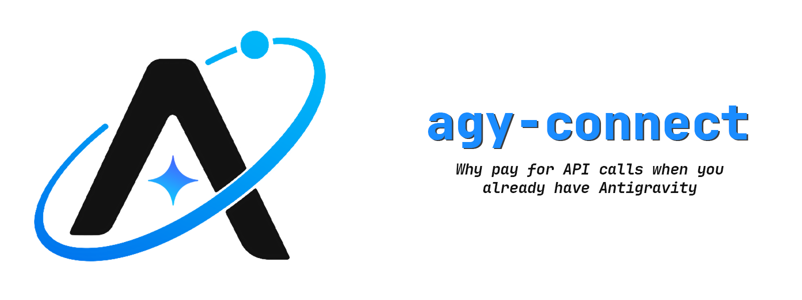

<div align="center">



# agy-connect


**A high-performance Python runtime and bridge for Google Antigravity CLI, turning your local CLI into a seamless AI provider with instant warm execution, real-time streaming, automated quota failover, and authentic terminal states.**

</div>

---

## Overview

The Google Antigravity CLI (`agy`) provides authenticated access to state-of-the-art AI models—including Gemini 3.8 Flash, Claude Sonnet 4.6, Claude Opus 4.6, and GPT-OSS 120B—directly on your workstation.

`agy-connect` transforms your local CLI installation into an embeddable Python AI engine:
- **Zero Cold-Boot Overhead (<20ms)**: Autonomous `WorkerPool` eliminates the 8-12 second Go CLI startup time by pre-warming background processes.
- **Bi-Directional Stream-JSON Protocol**: Runs persistent keep-alive subprocesses communicating over NDJSON (`--input-format stream-json --output-format stream-json`).
- **Authentic CLI Progress States**: Recreates native terminal feedback—ephemeral thinking states, live tool execution banners (`* Running <cmd>` -> `+ Ran <cmd> (1.4s)`), and token streaming.
- **Interactive Question & Permission Handling**: Intercepts `ask_question` and permission dialogs, routing them to your application hook without freezing subprocess pipes.
- **Automated Quota & Rate-Limit Failover**: Automatically recovers from HTTP 429 or quota limits by cycling through fallback models and replaying turns transparently.
- **Context-Preserving Model Switching**: Dynamically switch models mid-conversation while retaining complete conversation history.
- **Dual Synchronous & Asynchronous Architecture**: Clean `Chat` class for scripts and CLI apps; thread-safe, lock-guarded `Session` and `SessionManager` for FastAPI and web backends.

---

## Active Models

`agy-connect` dynamically queries and interfaces with models discovered by your local Antigravity CLI (`agy models`):

| Model ID | Provider | Mode | Description |
|---|---|---|---|
| `gemini-3.8-flash-low` | Google | Flash (Low) | Lowest reasoning latency for instantaneous chat and routing |
| `gemini-3.8-flash-medium` | Google | Flash (Medium) | Balanced speed and cognitive depth (default) |
| `gemini-3.8-flash-high` | Google | Flash (High) | Deep analytical reasoning with fast token throughput |
| `claude-sonnet-4-6` | Anthropic | Thinking | Premier coding, systems architecture, and complex tool use |
| `claude-opus-4-6-thinking` | Anthropic | Thinking | Maximum cognitive synthesis for advanced research and logic |
| `gpt-oss-120b-medium` | Open Source | Standard | High-parameter open-weights reasoning |

Discover available models programmatically at any time via `chat.models()`, `await session.list_models()`, or `list_models()`. Set `model=None` to inherit your global CLI default from `settings.json`.

---

## Architecture & Core Mechanics

<div align="center">


</div>

### 1. Persistent IPC Stream Engine
Rather than launching isolated CLI processes per turn, `agy-connect` maintains persistent subprocesses running Antigravity's bi-directional `stream-json` protocol. Prompts, tool calls, and results stream continuously over standard input/output pipes.

### 2. Autonomous Worker Pool
Cold-starting a Go-based language runtime incurs heavy startup costs. `WorkerPool` spawns warm workers in the background, verifies their initialization handshake, and hands over pre-authenticated sessions instantly upon request. Depleted workers are replenished automatically.

### 3. Concurrency Protection & History Integrity
Sessions serialize turns sequentially using asynchronous locking. If a turn is interrupted or fails due to network or process errors, uncompleted user prompts are rolled back automatically, preventing conversation history corruption.

### 4. Native CLI Visual States (`CliLiveRenderer`)
`CliLiveRenderer` parses structured stream events to match the native Antigravity terminal experience:
- **Thinking**: Displays an ephemeral `* Thinking...` status line, resolving into `* Thought (<duration>s)`.
- **Tool Execution**: Displays single-line sanitized `* Running <command>`, dynamically overwriting with `+ Ran <command> (<duration>s)`.
- **Streaming Tokens**: Clears ephemeral lines cleanly and renders token streams with customizable prompt prefixes (`Agy> `).

---

## Installation

```bash
pip install --upgrade agy-connect
```

**Requirements:**
- Python 3.9+
- [Google Antigravity CLI](https://antigravity.google/product/antigravity-cli) installed and authenticated (`agy` in PATH or configured via `Config`).

---

## Quick Start

### 1. Live Terminal Chat with CLI Progress States
`stream_cli` renders authentic thinking states, tool progress, and token streaming with a single call:

```python
from agy_connect import Chat, warmup

# Optional: pre-warm background worker for sub-20ms first turn
warmup(wait=False)

with Chat() as chat:
    while True:
        try:
            prompt = input("You> ").strip()
            if prompt.lower() in ("exit", "quit"):
                break
            
            # Renders * Thinking..., * Running <cmd>, + Ran <cmd>, and streams response
            chat.stream_cli(prompt, prefix="Agy> ")
        except (KeyboardInterrupt, EOFError):
            break
```

---

### 2. Synchronous Generation & Multi-Turn Memory
For scripts and automated pipelines:

```python
from agy_connect import Chat

with Chat() as chat:
    # First turn
    response = chat.send("My project name is CortexEngine.")
    print(response)

    # Conversation context is maintained automatically
    follow_up = chat.send("What is my project name?")
    print(follow_up)  # Recalls CortexEngine
```

---

### 3. Real-Time Token Streaming
Iterate over chunks as they arrive:

```python
import sys
from agy_connect import Chat

with Chat() as chat:
    sys.stdout.write("Agy> ")
    sys.stdout.flush()
    for chunk in chat.stream("Write a clean Python singleton pattern."):
        sys.stdout.write(chunk)
        sys.stdout.flush()
    print()
```

---

### 4. Dynamic Model Switching
Switch models mid-session without losing conversation history:

```python
from agy_connect import Chat

with Chat() as chat:
    chat.send("Our target database is PostgreSQL.")

    # Dynamically escalate to Claude Sonnet with full context preserved
    chat.switch_model("claude-sonnet-4-6")

    # Claude recalls previous context seamlessly
    reply = chat.send("Write an async migration script for our database.")
    print(reply)
```

---

### 5. Interactive Question & Permission Callbacks
When an agent invokes `ask_question` or requests approval, `agy-connect` forwards the prompt to your `on_question` callback and replies over stdin:

```python
from agy_connect import Chat

def handle_question(q: dict) -> dict:
    options = q.get("options", [])
    if options:
        # Programmatic selection or interactive user prompt
        return {"selected": options[0]}
    return {"response": "proceed"}

with Chat() as chat:
    reply = chat.send(
        "Initialize project configuration and scaffold directories",
        on_question=handle_question
    )
    print(reply)
```

---

### 6. Automated Quota & Rate-Limit Failover
Configure fallback models. If a 429 or quota limit is reached mid-session, `agy-connect` automatically falls back to the next model in the chain and replays the turn:

```python
from agy_connect import Chat, Config

config = Config(
    model="gemini-3.8-flash-high",
    fallback_models=["gemini-3.8-flash-medium", "gemini-3.8-flash-low"]
)

with Chat(config) as chat:
    response = chat.send("Analyze system telemetry and produce a performance summary.")
    print(response)
```

---

### 7. Asynchronous Multi-User Services (FastAPI)
Manage concurrent user sessions using `SessionManager`:

```python
from fastapi import FastAPI
from fastapi.responses import StreamingResponse
from agy_connect import SessionManager, Config

app = FastAPI()
manager = SessionManager(Config(use_pool=True, max_sessions=50))

@app.post("/chat/{user_id}")
async def chat_endpoint(user_id: str, prompt: str):
    session = await manager.get(user_id)

    async def token_generator():
        async for token in session.stream(prompt):
            yield token

    return StreamingResponse(token_generator(), media_type="text/plain")

@app.on_event("shutdown")
async def shutdown():
    await manager.shutdown()
```

---

### 8. Inspecting Structured Stream Events
Inspect granular lifecycle events (tools, thoughts, tokens, questions):

```python
from agy_connect import Chat

with Chat() as chat:
    for event in chat.stream_events("Check git status and summarize active branch"):
        if event.is_tool:
            print(f"Tool: {event.tool_name} | State: {event.state} | {event.duration_seconds}s")
        elif event.is_thinking:
            print(f"Thinking: {event.format_cli()}")
        elif event.is_question:
            print(f"Question Prompt: {event.question_data}")
        elif event.is_text:
            print(event.text_delta, end="", flush=True)
```

---

## Configuration Reference

Configure session parameters, models, timeouts, and process execution via `Config`:

```python
from agy_connect import Config

config = Config(
    model="gemini-3.8-flash-medium",       # Target AI model (None for CLI settings.json default)
    fallback_models=["gemini-3.8-flash-low"], # Automatic failover models on quota exhaustion
    effort=None,                            # Reasoning effort: "low"|"medium"|"high"|"xhigh"|"max"
    use_pool=True,                          # Instant handover from pre-warmed WorkerPool
    auto_warmup=True,                       # Pre-warm worker pool during startup
    dangerously_skip_permissions=True,      # Auto-approve tool execution without blocking
    working_directory=".",                  # Working directory for CLI execution
    executable_path=None,                   # Custom path to 'agy' executable (auto-discovered if None)
    idle_timeout=300.0,                     # Idle session cleanup threshold in seconds
    max_sessions=10,                        # Maximum concurrent sessions in SessionManager
    stream_chunk_size=4096,                 # Chunk read size in bytes
    debug_mode=False,                       # Enable verbose library debugging
    log_file=None,                          # Optional file path for library logs
    auto_recover=True                       # Automatically restart process on crash
)
```

---

## API Reference

### `Chat` (Synchronous Client)
| Method | Return Type | Description |
|---|---|---|
| `send(prompt, on_status=None, on_event=None, on_question=None)` | `str` | Sends prompt and returns full response string. |
| `stream(prompt, on_status=None, on_event=None, on_question=None)` | `Iterator[str]` | Synchronous generator yielding text chunks as they arrive. |
| `stream_cli(prompt, prefix="Agy> ", show_thinking=True, on_question=None)` | `str` | Renders live thinking indicators, tools, and token stream to stdout. |
| `stream_events(prompt, on_question=None)` | `Iterator[StreamEvent]` | Synchronous generator yielding rich lifecycle events. |
| `switch_model(model_id, effort=None)` | `None` | Switches active model while preserving conversation history. |
| `models()` | `List[Dict[str, str]]` | Discovers available models from local Antigravity CLI. |
| `history()` | `List[Dict[str, str]]` | Retrieves active conversation history. |
| `save(filepath=None)` | `None` | Persists conversation history to a JSON file. |
| `load(filepath)` | `None` | Restores conversation history from a JSON file. |
| `reset()` | `None` | Resets conversation history. |
| `status()` | `str` | Current adapter state (`READY`, `STREAMING`, `ERROR`, `STOPPED`). |
| `health()` | `Dict[str, Any]` | Process metrics (alive, PID, uptime, error state). |
| `restart()` | `None` | Gracefully restarts the underlying CLI process. |
| `interrupt()` | `None` | Interrupts current execution by restarting the process. |
| `close()` | `None` | Terminates process and releases resources. |

---

### `Session` (Asynchronous Client)
| Method | Return Type | Description |
|---|---|---|
| `await send(prompt, on_status=None, on_event=None, on_question=None)` | `str` | Asynchronously sends prompt and returns response string. |
| `async for chunk in stream(prompt, ...)` | `AsyncGenerator[str]` | Asynchronous generator yielding response tokens. |
| `async for event in stream_events(prompt, ...)` | `AsyncGenerator[StreamEvent]` | Asynchronous generator yielding rich `StreamEvent` objects. |
| `await switch_model(model_id, effort=None)` | `None` | Dynamically switches model while preserving context. |
| `await list_models()` | `List[Dict[str, str]]` | Non-blocking async model discovery. |
| `status()` | `str` | Returns current session adapter state. |
| `save(filepath)` / `load(filepath)` / `reset()` | `None` | Manages session history serialization. |
| `await restart(conversation_id=None)` | `None` | Asynchronously restarts underlying process. |
| `await cleanup()` | `None` | Terminates session process and cleans up resources. |

---

### `StreamEvent`
| Attribute | Type | Description |
|---|---|---|
| `event` | `str` | Event type (`step_update`, `result`, `question`, `interaction`). |
| `step_type` | `Optional[str]` | Sub-step type (`tool`, `thought`, `agent_response`, `user_input`). |
| `state` | `Optional[str]` | State (`ACTIVE`, `DONE`, `SUCCESS`, `ERROR`). |
| `text_delta` | `Optional[str]` | Incremental assistant response token text. |
| `thinking_delta` | `Optional[str]` | Incremental reasoning/thought content. |
| `tool_name` | `Optional[str]` | Tool executed (`run_command`, `read_file`, `write_file`, etc.). |
| `tool_parameters` | `Optional[Dict]` | Parameters passed to the tool. |
| `tool_output` | `Optional[str]` | Output string returned by the tool. |
| `duration_seconds` | `Optional[float]` | Execution time of the tool or thinking step. |
| `usage` | `Optional[Dict]` | Token counts (`input_tokens`, `output_tokens`, `thinking_tokens`, `total_tokens`). |
| `question_data` | `Optional[Dict]` | Question payload and interactive options. |
| `interaction_id` | `Optional[str]` | Unique interaction identifier. |
| `is_tool` | `bool` | True if event represents tool invocation. |
| `is_thinking` | `bool` | True if event represents reasoning/thought. |
| `is_text` | `bool` | True if event contains response tokens. |
| `is_question` | `bool` | True if event represents an interactive question. |
| `status_message` | `Optional[str]` | Formatted CLI status message. |
| `format_cli(color=True)` | `Optional[str]` | ANSI formatted line matching native CLI terminal style. |

---

## License

This project is licensed under the [MIT License](LICENSE).

---

## Disclaimer & Legal Notice

> [!IMPORTANT]
> **Independent Open-Source Tooling**: `agy-connect` is an independent client wrapper and inter-process communication (IPC) library. It does **not** host, operate, distribute, or license any artificial intelligence models, neural weights, compute infrastructure, or proxy services.

- **Local IPC Bridge Only**: `agy-connect` operates strictly as a local automation interface communicating with the user's locally installed, locally authenticated Google Antigravity CLI executable via standard input/output streams.
- **No Model Ownership or Reselling**: All model capabilities, tokens, and generation outputs originate entirely from the user's personal Antigravity CLI installation and account. `agy-connect` does not bypass authentication, circumvent billing, or provide unauthorized model access.
- **Terms & Compliance**: Use of this library requires a valid, pre-existing installation of Google Antigravity CLI. Users remain independently responsible for complying with Google's Terms of Service, Acceptable Use Policies, and the policies of respective underlying model providers (Google DeepMind, Anthropic, etc.).
- **Trademarks**: "Google", "Antigravity", "Gemini", "Claude", and related brand marks belong to their respective copyright and trademark holders. `agy-connect` is an independent community project and is not affiliated with, endorsed by, or sponsored by Google or Anthropic.
