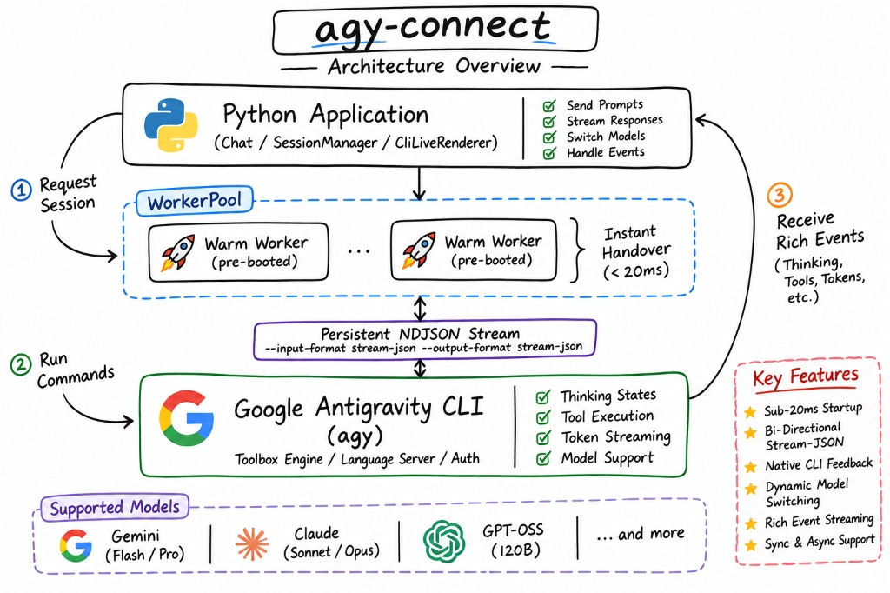

<div align="center">


# agy-connect


**A high-performance Python runtime for Google Antigravity CLI, delivering instant warm execution, token-by-token streaming, dynamic model switching, and authentic CLI progress states.**

</div>

---

## Why agy-connect?

Google Antigravity CLI provides authenticated access to premier AI models (Gemini 3.8 Flash, Gemini 3.1 Pro, Claude Sonnet 4.6, Claude Opus 4.6) directly from your workstation without third-party API key fees.

However, invoking a CLI tool programmatically often incurs heavy cold-boot costs (Go runtime startup, SQLite migrations, credentials checks) and loses rich terminal feedback.

`agy-connect` bridges this gap into a production-grade Python library:
- **Sub-20ms Startup Latency**: Pre-warmed `WorkerPool` eliminates the typical 8-12 second CLI cold boot.
- **Bi-Directional Stream-JSON Protocol**: Communicates via persistent, keep-alive stdio streams using Antigravity's native `stream-json` NDJSON protocol.
- **Native CLI Live Feedback**: Real-time rendering of thinking states (`* Thinking...`), tool executions (`* Running git status` -> `+ Ran git status (0.8s)`), and token streaming.
- **Dynamic Model Switching**: Switch LLMs on the fly (`chat.switch_model(...)`) within active conversations while seamlessly maintaining full context history.
- **Rich Event Streaming**: Inspect structured tool parameters, execution durations, thoughts, and text deltas directly in Python.
- **Dual Async/Sync Support**: Synchronous `Chat` for scripts and bots; asynchronous `SessionManager` for multi-user FastAPI/web services.

---

## Supported Models

`agy-connect` discovers and drives all models supported by your local Antigravity installation:

| Model ID | Provider | Mode | Description |
|---|---|---|---|
| `gemini-3.8-flash-low` | Google | Flash (Low Reasoning) | Ultra-fast responses with minimal thinking latency |
| `gemini-3.8-flash-medium` | Google | Flash (Medium Reasoning) | Balanced speed and analytical depth |
| `gemini-3.8-flash-high` | Google | Flash (High Reasoning) | Deep reasoning with fast token delivery |
| `gemini-3.7-flash` | Google | Flash | Fast, general-purpose intelligence |
| `gemini-3.6-flash` | Google | Flash | High-throughput, low-latency generation |
| `gemini-3.1-pro-high` | Google | Pro (High Reasoning) | Maximum cognitive capacity for complex workflows |
| `gemini-3.1-pro-low` | Google | Pro (Low Reasoning) | Advanced pro reasoning with streamlined generation |
| `claude-sonnet-4-6` | Anthropic | Hybrid Thinking | State-of-the-art coding and architecture reasoning |
| `claude-opus-4-6` | Anthropic | Deep Thinking | Complex multi-stage synthesis and logic |
| `gpt-oss-120b-medium` | Open Source | Standard | Local/open-source weights reasoning |

Discover models programmatically at any time via `chat.models()` or `list_models()`.

---

## Architecture & Core Mechanics

<div align="center">



</div>

### 1. Persistent Keep-Alive Protocol
Rather than spawning isolated CLI processes per turn, `agy-connect` maintains persistent subprocesses running `--input-format stream-json --output-format stream-json`. Prompts and responses stream continuously over NDJSON pipes, eliminating repeated CLI bootstrap overhead.

### 2. Autonomous WorkerPool
Cold-starting a Go-based language server process takes 8-12 seconds on average. `agy-connect` provides an autonomous `WorkerPool` that spawns warm background workers ahead of time, waits for their initialisation event, and hands over pre-authenticated sessions instantly upon request. A background task replenishes depleted workers asynchronously.

### 3. Context-Preserved Model Switching
When switching models mid-session, `agy-connect` leverages native Antigravity session resumption (`--conversation <id>`). History is retained across model switches, allowing applications to start with a fast flash model for intent routing and dynamically escalate to Claude Sonnet or Gemini Pro for coding tasks.

### 4. Native CLI Visual States (`CliLiveRenderer`)
`agy-connect` decodes structured `step_update` events from the CLI runtime to reproduce terminal feedback:
- **Thinking**: Displays an ephemeral `* Thinking...` status line.
- **Tool Execution**: Displays `* Running <command>`, dynamically overwriting with `+ Ran <command> (<duration>s)` upon completion.
- **Streaming Tokens**: Clears active status lines and streams tokens with an optional prompt prefix (e.g. `Agy> `).

---

## Installation

```bash
pip install agy-connect
```

**Prerequisites:**
- Python 3.9+
- [Google Antigravity CLI](https://antigravity.google/product/antigravity-cli) installed and authenticated on your workstation (`agy` executable in PATH or configured via `Config`).

---

## Quick Start

### 1. Interactive Terminal Chat with Live CLI States
Using `stream_cli` gives you instant warm startup, live thinking indicators, tool execution feedback, and token-by-token streaming with one call:

```python
from agy_connect import Chat, Config, warmup

# Pre-warm pool worker in background
warmup(wait=False)

# Start session
with Chat() as chat:
    while True:
        try:
            user_input = input("You> ").strip()
            if user_input.lower() in ("exit", "quit"):
                break
            
            # Displays * Thinking..., * Running <cmd>, + Ran <cmd>, and streams tokens
            chat.stream_cli(user_input, prefix="Agy> ")
        except (KeyboardInterrupt, EOFError):
            break
```

---

### 2. Basic Synchronous Chat
For automation scripts and simple query pipelines:

```python
from agy_connect import Chat

with Chat() as chat:
    # Send a prompt and receive the full response
    response = chat.send("Summarize the benefits of event-driven architectures.")
    print(response)

    # Conversation context is maintained automatically
    follow_up = chat.send("Give me 3 concrete examples of that.")
    print(follow_up)
```

---

### 3. Real-Time Token Streaming
Iterate over streamed tokens as they are generated:

```python
import sys
from agy_connect import Chat

with Chat() as chat:
    print("Agy> ", end="", flush=True)
    for token in chat.stream("Write a Python generator for Fibonacci numbers."):
        sys.stdout.write(token)
        sys.stdout.flush()
    print()
```

---

### 4. Dynamic Model Switching
List discovered models and switch the active model at runtime without losing conversation history:

```python
from agy_connect import Chat

with Chat() as chat:
    # Inspect models available in your CLI
    models = chat.models()
    for m in models:
        print(f"[{m['id']}] {m['name']}")

    # Start conversation on fast model
    chat.send("My project name is AlphaForge.")

    # Dynamically escalate to high-reasoning Claude Sonnet with preserved context
    chat.switch_model("claude-sonnet-4-6")
    
    # Model recalls "AlphaForge" without re-sending prompt history
    reply = chat.send("What is my project name and how should I architect it?")
    print(reply)
```

---

### 5. Inspecting Rich Stream Events
Capture detailed lifecycle events (tool invocations, parameters, thoughts, durations):

```python
from agy_connect import Chat

with Chat() as chat:
    for event in chat.stream_events("List the files in the current directory."):
        if event.is_tool:
            print(f"Tool: {event.tool_name} | State: {event.state} | Duration: {event.duration_seconds}s")
        elif event.is_thinking:
            print(f"Reasoning update: {event.thinking_delta}")
        elif event.is_text:
            print(event.text_delta, end="", flush=True)
```

---

### 6. Asynchronous Multi-User Applications (FastAPI)
Manage independent sessions across concurrent users using `SessionManager`:

```python
from fastapi import FastAPI
from fastapi.responses import StreamingResponse
from agy_connect import SessionManager, Config

app = FastAPI()
manager = SessionManager(Config(use_pool=True, max_sessions=50))

@app.post("/chat/{user_id}")
async def chat_endpoint(user_id: str, prompt: str):
    session = await manager.get(user_id)

    async def token_generator():
        async for token in session.stream(prompt):
            yield token

    return StreamingResponse(token_generator(), media_type="text/plain")

@app.on_event("shutdown")
async def shutdown():
    await manager.shutdown()
```

---

## Configuration

Configure session parameters, worker pools, paths, and timeouts via `Config`:

```python
from agy_connect import Chat, Config

config = Config(
    model="gemini-3.8-flash-low",          # Target AI model (None for CLI default)
    use_pool=True,                         # Instant handover from WorkerPool
    auto_warmup=True,                      # Pre-warm pool during instantiation
    dangerously_skip_permissions=True,     # Allow CLI tool execution without modal prompts
    working_directory=".",                 # Subprocess working directory
    executable_path=None,                  # Custom path to 'agy' binary (auto-discovered if None)
    idle_timeout=300,                      # Idle timeout in seconds
    debug_mode=False                       # Enable verbose logging
)

chat = Chat(config)
```

---

## API Reference

### `Chat`
| Method | Description |
|---|---|
| `send(prompt, on_status=None, on_event=None)` | Sends prompt synchronously and returns complete response string. |
| `stream(prompt, on_status=None, on_event=None)` | Yields response tokens as a synchronous iterator. |
| `stream_cli(prompt, prefix="Agy> ", show_thinking=True)` | Streams response with live terminal states (`* Thinking...`, `* Running`, `+ Ran`). |
| `stream_events(prompt)` | Yields structured `StreamEvent` objects (tools, thoughts, text). |
| `switch_model(model_id, effort=None)` | Switches active model dynamically while preserving conversation history. |
| `models()` | Discovers all available models supported by the local Antigravity installation. |
| `history()` | Returns current conversation history list. |
| `save(filepath=None)` | Persists conversation history to a JSON file. |
| `load(filepath)` | Restores conversation history from a JSON file. |
| `reset()` | Clears conversation memory. |
| `status()` | Returns adapter state (`READY`, `STREAMING`, `ERROR`, `STOPPED`). |
| `health()` | Returns process health metrics (PID, uptime, process alive). |
| `restart()` | Restarts underlying CLI subprocess. |
| `close()` | Gracefully terminates session and releases process resources. |

---

### `StreamEvent`
| Attribute | Type | Description |
|---|---|---|
| `event` | `str` | Event type (`step_update`, `result`). |
| `step_type` | `Optional[str]` | Sub-step type (`tool`, `thought`, `agent_response`, `user_input`). |
| `state` | `Optional[str]` | Execution state (`ACTIVE`, `DONE`, `SUCCESS`, `ERROR`). |
| `text_delta` | `Optional[str]` | Incremental text content from the assistant. |
| `thinking_delta`| `Optional[str]` | Incremental reasoning/thinking content. |
| `tool_name` | `Optional[str]` | Name of the tool being executed (e.g. `run_command`, `read_file`). |
| `tool_parameters`| `Optional[Dict]`| Parameters passed to the tool. |
| `tool_output` | `Optional[str]` | Output string returned by the tool. |
| `duration_seconds`| `Optional[float]`| Execution time in seconds. |
| `format_cli()` | `Optional[str]` | Formatted ANSI string matching native CLI terminal style. |

---

## License

This project is licensed under the [MIT License](LICENSE).
